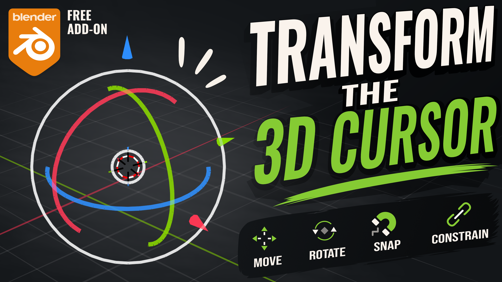
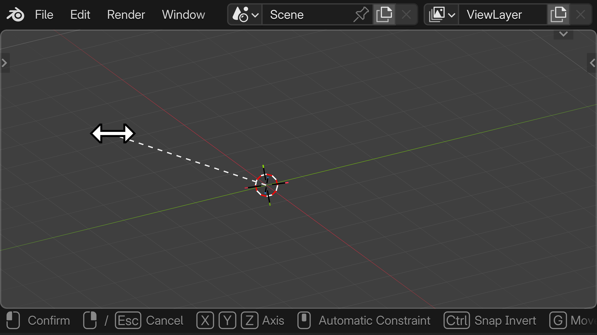
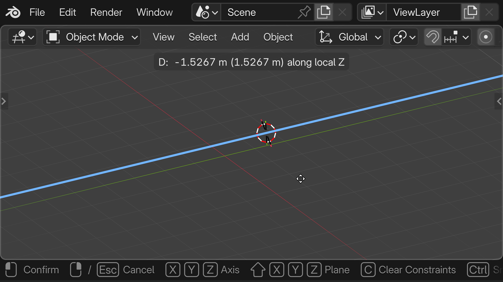
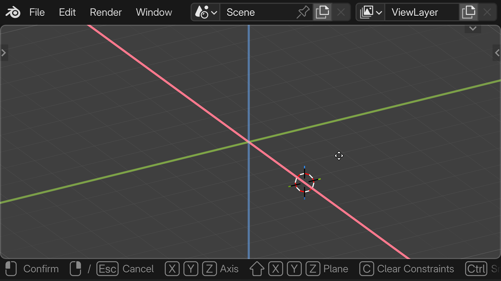
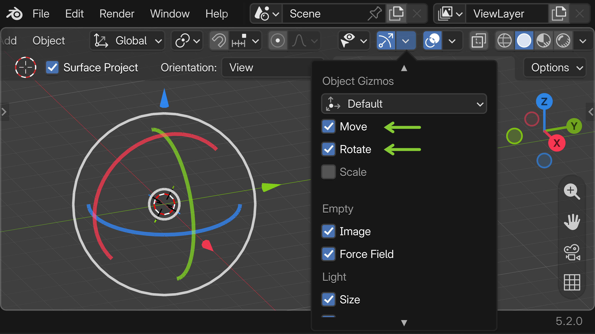
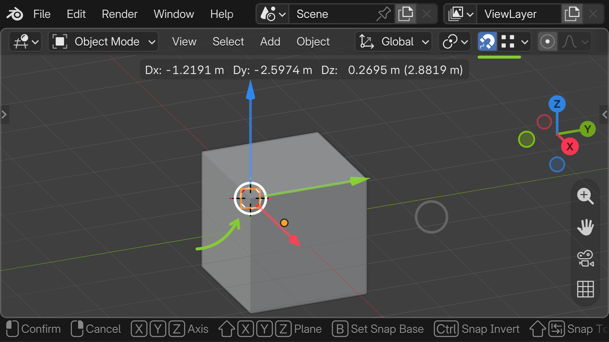

[▶ Watch the full tutorial on YouTube](https://youtu.be/btT_od7eQNs)

# 3D Cursor Transform

Bring Blender's full transform system to the 3D Cursor.

Move and rotate the 3D Cursor using Blender's familiar keyboard shortcuts and transform gizmos. Constrain movement with X, Y, and Z, use plane constraints, snapping, precision mode, and numeric input — all integrated into the existing Blender workflow.

## Why this add-on exists

Blender already provides an excellent transform system for objects. The 3D Cursor has always been one of Blender's most powerful tools, but it can't be transformed using that same system.

I often use the 3D Cursor as a placement and modeling tool, and I found myself wanting those same transform controls for the 3D Cursor as well. So I built this add-on.

It extends Blender's existing transform system to the 3D Cursor, allowing you to move and rotate it using the same shortcuts, constraints, snapping, and gizmos you can use with objects.

## Features

By default, the add-on's transform controls are available when the **3D Cursor tool** is active.

- Move and rotate the 3D Cursor using Blender's familiar **G** and **R** shortcuts.
- Reset the 3D Cursor's location and rotation using **Alt + G** and **Alt + R**.
- Constrain transformations to the **X**, **Y**, and **Z** axes, including orientation switching by pressing the axis key again.
- Use **plane constraints** with **Shift + X**, **Shift + Y**, and **Shift + Z**.
- Support for **numeric input** and **Arrow key** adjustments for precise transformations.
- Hold **Shift** for precision mode.
- Use Blender's built-in **snapping** system.
- Transform the 3D Cursor using dedicated **Move** and **Rotate gizmos**.

Additionally, the add-on preferences offer two optional settings that extend these controls beyond the 3D Cursor tool:

- **Global transform shortcuts:** Use the 3D Cursor's transform shortcuts with another tool active when nothing is selected.
- **Global transform gizmos:** Display the 3D Cursor's Move and Rotate gizmos with another tool active when nothing is selected.

## Installation

3D Cursor Transform can be installed directly through Blender Extensions or manually from the latest release on the [GitHub Releases](../../releases) page.

### Blender Extensions (Recommended)

1. Open **Edit → Preferences → Get Extensions**.
2. Search for **3D Cursor Transform**.
3. Click **Install**.
4. Enable the add-on if it is not enabled automatically.

### Manual Installation

1. Download the latest release from the GitHub **Releases** page.
2. In Blender, open **Edit → Preferences → Add-ons**.
3. Click the ▼ menu in the top-right corner and choose **Install from Disk...**.
4. Browse to the downloaded .zip file and select it.
5. Enable **3D Cursor Transform**.

## Usage

3D Cursor Transform is designed to work exactly like Blender's native transform system. By default, simply select the 3D Cursor tool to access the add-on's transform features.

If you're already familiar with transforming objects, you'll feel right at home using the same shortcuts and controls with the 3D Cursor.

### Transform the 3D Cursor

With the **3D Cursor tool** active, press **G** to move or **R** to rotate the 3D Cursor.

Use **Alt + G** to reset the cursor's location to the world origin, or **Alt + R** to reset its rotation.

### Global 3D Cursor Transform

By default, the add-on's transform controls are available when the **3D Cursor tool** is active. You can extend these controls to other tools through the **Global 3D Cursor Transform** settings.

To access these settings:

1. Open **Edit → Preferences → Add-ons**.
2. Find **3D Cursor Transform** and expand its preferences.
3. Locate the **Global 3D Cursor Transform** section.

Two independent settings are available:

- **Global Transform Shortcuts:** Use **G**, **R**, **Alt + G**, and **Alt + R** to transform or reset the 3D Cursor when nothing is selected, without switching to the 3D Cursor tool.
- **Global Transform Gizmos:** Display the 3D Cursor's Move and Rotate gizmos when nothing is selected, without switching to the 3D Cursor tool.

**Both settings are automatically enabled the first time the add-on is activated.** This allows you to discover and try the additional functionality immediately, without having to configure anything.

After the initial activation, your preferences are respected. You can enable or disable either setting independently, and the add-on will not automatically re-enable settings you've turned off.

Global shortcuts work in Object Mode, Pose Mode, and supported Edit Modes. When something is selected, Blender's regular selection-based transform controls remain available.

Global gizmo visibility follows Blender's native gizmo toggles. The **Move** and **Rotate** gizmos must be enabled in the viewport to access the corresponding global cursor gizmos.

### Constrain the 3D Cursor

Use **X**, **Y**, and **Z** to constrain transformations to an axis. Press the same axis key again to switch between **Global** and **Local** orientations, or use **Shift + X**, **Shift + Y**, and **Shift + Z** for plane constraints.

### MMB Axis Selection

During a transformation, press **MMB** to pick an axis directly from the viewport.

### Transform Gizmo

Enable the **Move** and **Rotate** gizmos from **Viewport Header → Show Gizmo** to transform the 3D Cursor using Blender's familiar gizmo controls.

### Precision and Snapping

During a transform, use the **Arrow keys** to make small adjustments, enter numeric values for precise transformations, or hold **Shift** for precision mode.

Use **Ctrl** to temporarily enter Blender's snapping system and snap the 3D Cursor onto whatever you want.

For complete documentation, visit the [VertexCuriosity](https://vertexcuriosity.com/addons-and-apps/blender-addons/3d-cursor-transform) website.

## Limitations

When using the 3D Cursor tool, Blender may display both the selected element's transform gizmo and the add-on's 3D Cursor gizmo at the same time.

If you prefer a less cluttered viewport, simply deselect everything first.

Currently, 3D Cursor Transform supports **Global** and **Local** transform orientations. Other transform orientations are not supported at this time, as I haven't found a practical use for them when transforming the 3D Cursor.

If useful applications for other orientations come up in the future, I may add support for them as well.

## License

3D Cursor Transform is licensed under the GPL-3.0-or-later.

See the [LICENSE](LICENSE) file for details.
