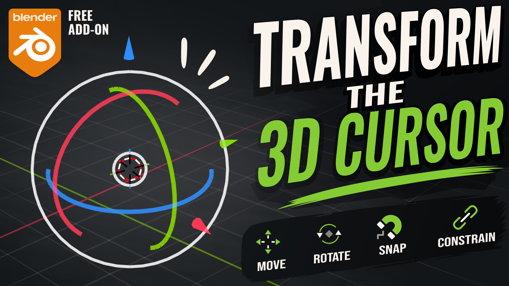
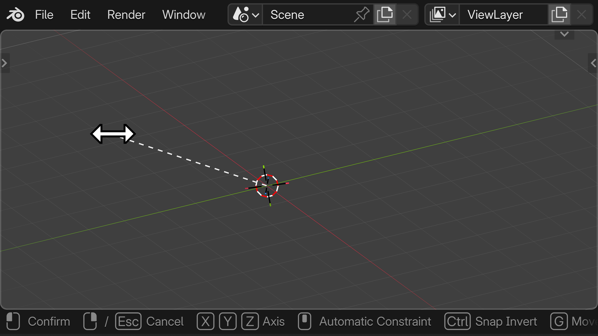
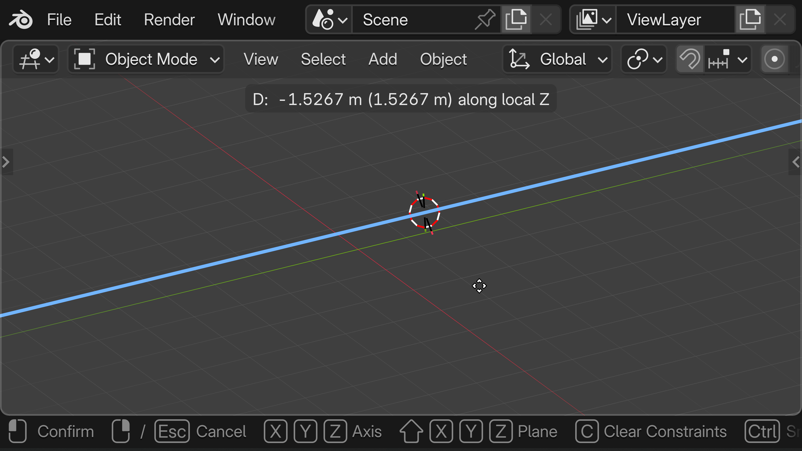
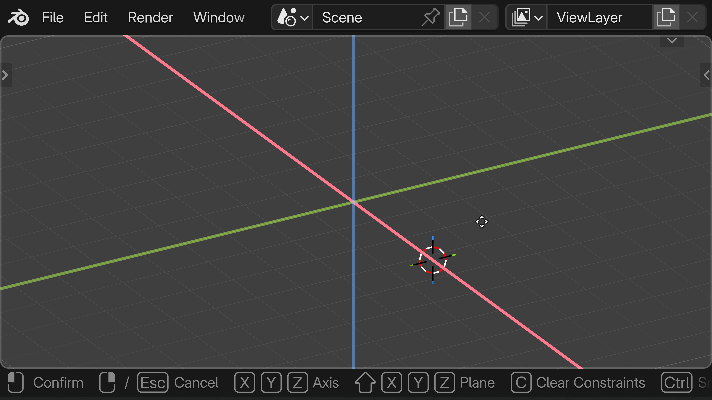
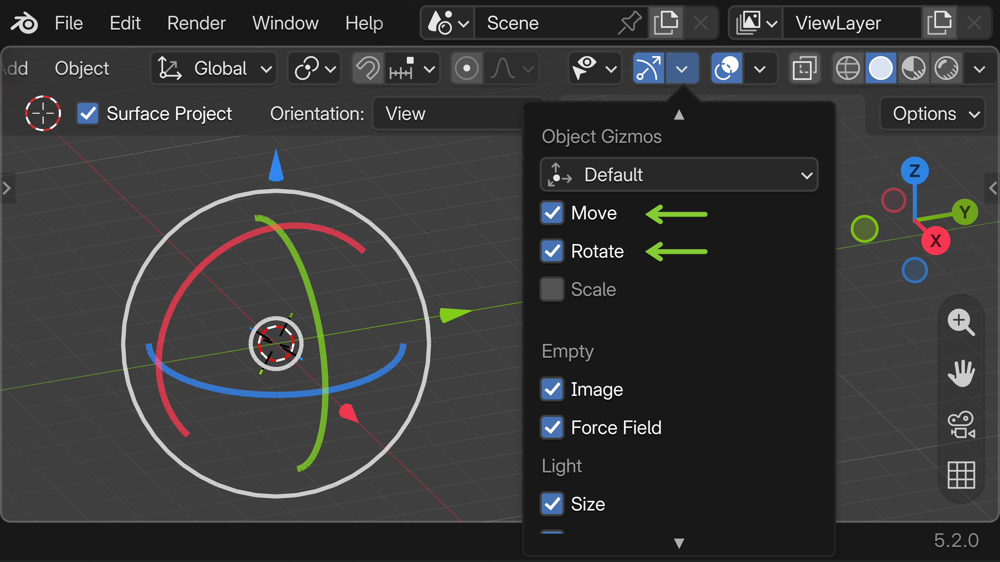
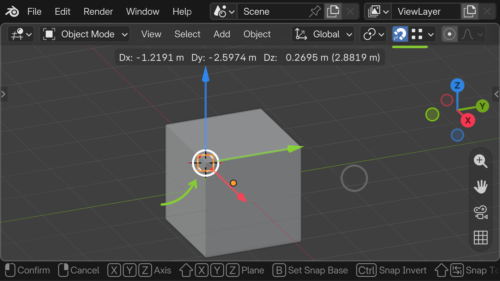

# 3D Cursor Transform

Bring Blender's full transform system to the 3D Cursor.

Move and rotate the 3D Cursor using Blender's familiar keyboard shortcuts and transform gizmos. Constrain movement with X, Y, and Z, use plane constraints, snapping, precision mode, and numeric input — all integrated into the existing Blender workflow.

## Why this add-on exists

Blender already provides an excellent transform system for objects. The 3D Cursor has always been one of Blender's most powerful tools, but it can't be transformed using that same system.

I often use the 3D Cursor as a placement and modeling tool, and I found myself wanting those same transform controls for the 3D Cursor as well. So I built this add-on.

It extends Blender's existing transform system to the 3D Cursor, allowing you to move and rotate it using the same shortcuts, constraints, snapping, and gizmos you already know.

## Features

- Move and rotate the 3D Cursor using Blender's familiar **G** and **R** shortcuts.
- Reset the 3D Cursor's location and rotation using **Alt + G** and **Alt + R**.
- Constrain transformations to the **X**, **Y**, and **Z** axes, including orientation switching by pressing the axis key again.
- Use **plane constraints** with **Shift + X**, **Y**, and **Z**.
- Support for **numeric input** and **Arrow key** adjustments for precise transformations.
- Hold **Shift** for precision mode.
- Use Blender's built-in **snapping** system.
- Transform the 3D Cursor using dedicated **move** and **rotate gizmos**.

## Installation

3D Cursor Transform can be installed directly through Blender Extensions or manually from the latest release on the [GitHub Releases](../../releases) page.

### Blender Extensions (Recommended)

1. Open **Edit → Preferences → Get Extensions**.
2. Search for **3D Cursor Transform**.
3. Click **Install**.
4. Enable the add-on if it is not enabled automatically.

### Manual Installation

1. Download the latest release from the GitHub **Releases** page.
2. In Blender, open **Edit → Preferences → Add-ons**.
3. Click the ▼ menu in the top-right corner and choose **Install from Disk...**.
4. Browse to the downloaded .zip file and select it.
5. Enable **3D Cursor Transform**.

## Usage

3D Cursor Transform is designed to work exactly like Blender's native transform system. If you're already familiar with transforming objects, you'll feel right at home using the same shortcuts and controls with the 3D Cursor.

### Transform the 3D Cursor

Select the **3D Cursor** tool and press **G** to move or **R** to rotate the 3D Cursor.

Use **Alt + G** to reset the cursor's location to the world origin, or **Alt + R** to reset its rotation.

### Constraints

Use **X**, **Y**, and **Z** to constrain transformations to an axis. Press the same axis key again to cycle through the available transform orientations, or use **Shift + X**, **Y**, and **Z** for plane constraints.

### Mouse Axis Selection

During a transformation, press **MMB** to pick an axis directly from the viewport.

### Transform Gizmo

Enable the **Move** and **Rotate** gizmos from **Viewport Header → Show Gizmo** to transform the 3D Cursor using Blender's familiar gizmo controls.

### Precision and Snapping

During a transform, use the **Arrow keys** to make small adjustments, enter numeric values for precise transformations, or hold **Shift** for precision mode. Use **Ctrl** to temporarily enter Blender's snapping system and snap the 3D Cursor onto whatever you want.

For complete documentation, visit the [VertexCuriosity](https://vertexcuriosity.com/addons-and-apps/apps/3d-cursor-transform) website.

## Limitations

When the 3D Cursor gizmo is visible and another element in the scene is selected, Blender also displays the transform gizmo for that selection. This means two gizmos will be visible at the same time: Blender's selection gizmo and the add-on's 3D Cursor gizmo.

If you prefer a less cluttered viewport while using the 3D Cursor tool, simply deselect everything first.

Currently, 3D Cursor Transform supports **Global** and **Local** transform orientations. Other transform orientations are not supported at this time, as I haven't found a practical use for them when transforming the 3D Cursor.

If useful applications for other orientations come up in the future, I may add support for them as well.

## License

3D Cursor Transform is licensed under the GPL-3.0-or-later.

See the [LICENSE](LICENSE) file for details.
